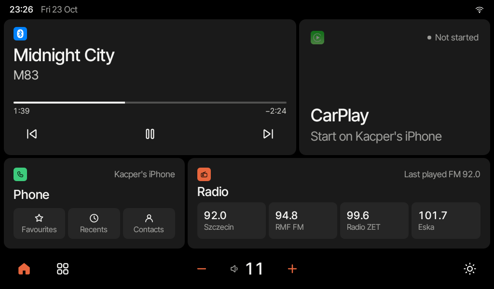

# Sirion launcher

A home screen for the aftermarket Android head unit in a 2005 Daihatsu Sirion. It replaces the unit's own launcher with one calm screen for music, CarPlay, calls and radio, built for a 1024×600 display and for use while driving.



## What it does

- **Home:** what's playing over Bluetooth with its controls, CarPlay, the phone (favourites, recents, contacts) and four radio presets. Volume and brightness sit in a bar at the bottom of every screen.
- **Phone:** calls through the car with contact photos, recents that update after every call, and the favourites you share from your iPhone.
- **Radio, music and settings:** the unit's FM tuner, Bluetooth music, sound (EQ, balance and fader), display brightness that follows the sun, button lights, Bluetooth and Wi-Fi.
- **CarPlay:** opens when you tap it, after the unit starts, or for a call or Siri, not every time the iPhone asks.
- **Updates:** new versions download in the background. Settings · System shows what changed, and nothing installs until you tap Install. A version that doesn't start properly is rolled back.

## The unit

Autochips AC8227L, Android 8.1, 1024×600. The launcher uses Android's own APIs where it can, and a small root helper for the rest (the tuner, the audio chip, brightness). It never writes to `/system`.

## Building

```bash
./gradlew testDebugUnitTest assembleDebug
```

`adb shell setprop debug.sirion.demo 1` fills a debug build with made-up music, contacts and calls, as in the screenshot.

## Font

Inter Tight, under the SIL Open Font License (`third_party/InterTight-OFL.txt`).
